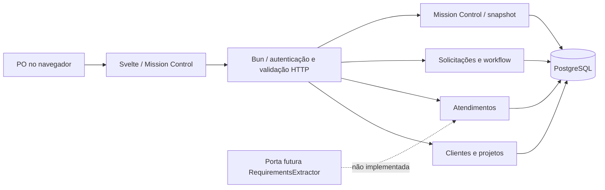
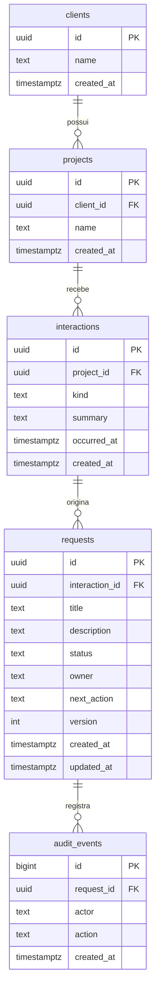

# Arquitetura do Catus OS

## Contexto e decisões M0

Monólito modular em TypeScript strict. Um processo Bun atende HTTP; Svelte 5 + Vite compõem a interface; PostgreSQL é a única fonte de verdade. Não há microsserviços, fila externa, Kubernetes, provedor de IA, Google Chat ou Meet. Node é ferramenta de instalação e de desenvolvimento do PostgreSQL; o backend executa em Bun.

- **Bun.serve em vez de framework HTTP:** superfície pequena, APIs Web padrão, menos dependências. A função `createApp` pode ser testada sem abrir porta e serve a mesma aplicação usada no navegador.
- **pg e SQL explícito em vez de ORM:** relações, transações e locks visíveis e migrations revisáveis. `pg` é a única dependência de runtime do servidor além do Bun. Pool limitado e timeout de statement evitam ocupação ilimitada por consultas.
- **Svelte 5 com runes:** formulários acessíveis, estado local e bundle pequeno; sem biblioteca de UI ou gerenciador global de estado nesta fatia.
- **PostgreSQL de desenvolvimento via embedded-postgres:** binários reais, persistência em disco e execução sem Docker/root. O pacote de tooling tem versão beta; não integra o backend nem é recomendação para produção. `DATABASE_URL` permite substituí-lo por PostgreSQL gerenciado/instalado sem mudar código.
- **Token local:** barreira inicial de acesso, não sistema de autenticação empresarial. O servidor bloqueia modo de produção. Trocar por identidade individual antes de acesso compartilhado.

## Limites dos módulos

| Módulo                | Responsabilidade                                           | Caminho                                 |
| --------------------- | ---------------------------------------------------------- | --------------------------------------- |
| Clientes              | Registro do cliente                                        | `src/server/modules/clients.ts`         |
| Projetos              | Projeto vinculado a cliente existente                      | `src/server/modules/projects.ts`        |
| Atendimentos          | Contexto manual e data de reunião/atendimento              | `src/server/modules/interactions.ts`    |
| Solicitações          | Criação, transições, responsável, ação, versão e auditoria | `src/server/modules/requests.ts`        |
| Mission Control       | Leitura consistente das relações operacionais              | `src/server/modules/mission-control.ts` |
| Extração              | Contratos de entrada/proposta e capability indisponível    | `src/server/extraction.ts`              |
| Transporte            | Autenticação, origem, limite de corpo, despacho e erros    | `src/server/app.ts`                     |
| Domínio compartilhado | Estados, transições, limites e tipos de leitura            | `src/shared/domain.ts`                  |

Módulos têm acesso ao mesmo banco; não há chamadas HTTP internas. Relações entre eles usam IDs e chaves estrangeiras. O frontend consome contratos de leitura e chama apenas a API; não acessa o banco. O único componente de página é aceitável nesta fatia pequena, mas deve ser dividido quando novas telas surgirem.

## Modelo de dados

`schema_migrations` registra nomes aplicados. Todas as entidades operacionais usam UUID gerado pelo servidor. Nomes não são únicos: clientes/projetos podem ter homônimos; não deduplicar por nome. Índices cobrem chaves estrangeiras de navegação. Não há remoção via API nem cascatas destrutivas. Os campos obrigatórios têm limites também no banco. Responsável é texto provisório, a migrar para `users` com estratégia de resolução explícita; não haverá associação silenciosa por nome.

## Workflow e consistência

Solicitações novas entram sempre em `new`. Alterar o estado não representa aprovação comercial ou autorização para agentes.

| Estado atual | Próximos estados permitidos  |
| ------------ | ---------------------------- |
| new          | triage                       |
| triage       | ready, blocked               |
| ready        | in_progress, triage, blocked |
| in_progress  | done, blocked                |
| blocked      | triage, ready, in_progress   |
| done         | triage                       |

É possível manter o estado para alterar responsável e próxima ação. Toda atualização exige versão atual: transação faz `SELECT FOR UPDATE`, verifica versão, valida transição, incrementa versão e registra auditoria; qualquer falha desfaz tudo. Criação e primeiro evento também são atômicos. O snapshot do Mission Control usa transação read-only repeatable-read para não misturar relacionamentos de momentos diferentes. Migrations são serializadas com advisory lock e aplicadas em transação. Não há auto-migration ao subir a API.

## Segurança e confiabilidade

Boundaries HTTP validam tipo, tamanho, UUID, campos e estados. Queries usam parâmetros; dados de usuário são sempre texto escapado na UI. Token com mínimo de 32 caracteres, comparação em tempo constante após verificação de tamanho, nenhum segredo no frontend ou logs. Backend e PostgreSQL bindam em loopback, sem credenciais reais. Conexões ao banco têm pool de 10 e timeout de consulta de 5s. Respostas da API usam `no-store`, `nosniff` e restrição de framing; a CSP da API não substitui a política de um futuro servidor de assets.

A identidade do ator está fixa em `local-developer`: útil para eventos técnicos locais, insuficiente para auditoria individual. Antes de uso compartilhado: OIDC/sessões, usuários e papéis (PO, engenharia, gestor, administrador), autorização em cada operação e escopo de organização, cookies seguros/CSRF se houver sessões, conta de banco com privilégio mínimo, rate limit, TLS, retenção e proteção de dados, backups com restauração testada e observabilidade. Nenhuma dessas capacidades está implicitamente pronta.

## Porta de extração e evolução

`RequirementsExtractor.extract(input, signal)` recebe ID e texto de origem; retorna propostas com título, descrição, evidências e perguntas. Sem implementação ou endpoint que simule inferência. A capacidade atual responde `available:false`. Próxima etapa deve adicionar rastreabilidade de versão do modelo/prompt, limites de custo/tempo, consentimento e política de dados, validação estrutural, fixtures e revisão humana. Proposta não vira escopo aprovado automaticamente.

Economia, contratos, horas e execução por agentes são módulos futuros. Valores financeiros serão unidades monetárias exatas (`numeric` ou centavos), com moeda, vigência de taxas, snapshots das premissas e trilha de aprovação. Jobs futuros podem começar com tabela/outbox no PostgreSQL, com idempotência, retries limitados e revisão humana; não há justificativa atual para serviço de filas externo.
