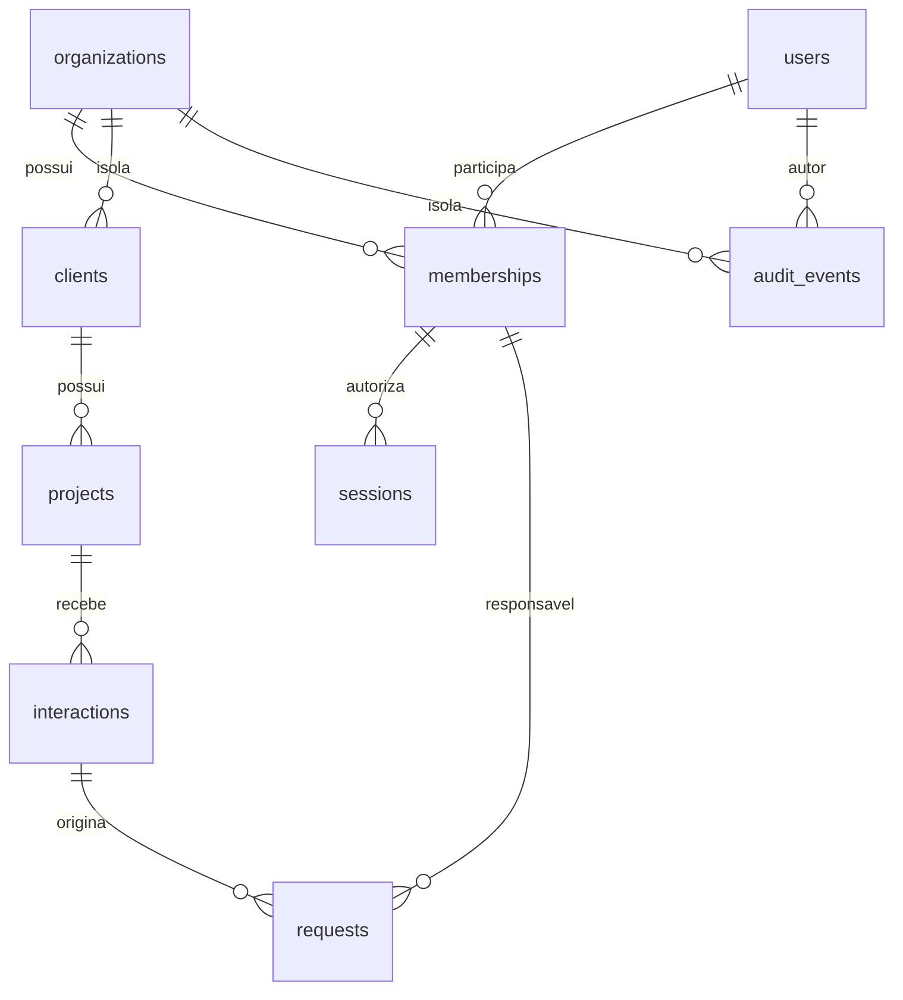

# Arquitetura do Catus OS — M1

## Estrutura e decisões

Monólito modular: Bun.serve + TypeScript strict, Svelte 5 com runes/Vite, PostgreSQL como fonte de verdade. SQL explícito via `pg`, sem ORM, microserviços, Kubernetes ou fila externa. `embedded-postgres` é somente tooling local, com dados em disco e banco PostgreSQL real. A stack e o fluxo funcional M0 foram mantidos; seu token compartilhado foi removido da autenticação.

`openid-client` 6.8.8 é a dependência adicionada ao servidor para protocolo e validação OIDC. Implementar JWT/OAuth manualmente aumentaria risco. A configuração usa discovery HTTPS, Authorization Code com PKCE S256, state, nonce e verificação explícita de assinatura (`enableNonRepudiationChecks`). Claims de issuer/audience/exp/nonce são verificados pela biblioteca; email verificado e domínio Workspace são exigidos pela política local. Não há fallback quando configuração está ausente/parcial; não há bypass de login em desenvolvimento.

## Módulos e fronteiras

| Área                           | Responsabilidade                                                       | Código                                     |
| ------------------------------ | ---------------------------------------------------------------------- | ------------------------------------------ |
| Configuração                   | Origem exata, HTTPS, conjunto OIDC completo                            | `src/server/config.ts`                     |
| OIDC                           | Discovery, desafio, callback, claims, vinculação de identidade         | `src/server/auth/oidc.ts`                  |
| Sessões/cookies                | Digests, expiração, CSRF, revogação e organização                      | `src/server/auth/session.ts`, `cookies.ts` |
| Políticas/auditoria            | Permissões com negação padrão e autor verificado                       | `src/server/auth/policy.ts`                |
| Membros                        | Provisionar, alterar papel e revogar no escopo atual                   | `src/server/modules/memberships.ts`        |
| Clientes/projetos/atendimentos | Contexto manual no escopo da organização                               | `src/server/modules/`                      |
| Solicitações                   | Workflow, responsável real, versão e regras do desenvolvedor           | `src/server/modules/requests.ts`           |
| Mission Control                | Snapshot consistente, membros e auditoria da organização               | `src/server/modules/mission-control.ts`    |
| Transporte                     | Rotas, sessão, CSRF, payload, transação e erros                        | `src/server/app.ts`                        |
| Frontend                       | Login, sessão/organização, formulários, cartões e administração mínima | `src/web/`                                 |
| Extração                       | Porta futura indisponível, sem simular IA                              | `src/server/extraction.ts`                 |

O transporte constrói `Context` somente após consultar sessão e vínculo no banco. Esse contexto contém conexão transacional, usuário, organização e papel atual; módulos não recebem identidade do payload nem usam pool global. Cada função pública de módulo verifica sua permissão. Toda escrita de negócio e seu evento de auditoria pertencem à mesma transação. O `Context` é fronteira interna confiável, não uma estrutura deserializável do cliente.

## Identidade e autorização

```mermaid
sequenceDiagram
 participant U as Funcionário
 participant A as Catus/Bun
 participant P as Provedor OIDC
 participant D as PostgreSQL
 U->>A: GET auth/login
 A->>D: state hash + nonce + PKCE verifier (10min)
 A-->>U: Cookie de state HttpOnly e redirect
 U->>P: Authorization Code + PKCE S256
 P-->>U: Redirect com code/state
 U->>A: callback + cookie state
 A->>D: Consome transação de login
 A->>P: Troca code usando verifier e autenticação do cliente
 P-->>A: ID token
 A->>A: Verifica assinatura, issuer, audience, nonce, exp, email e hd
 A->>D: Localiza usuário provisionado e vínculo ativo
 A->>D: Vincula sub se pendente; cria digest de sessão e auditoria
 A-->>U: Cookie de sessão opaco; redirect para origem fixa
 U->>A: API com cookie; CSRF nas escritas
 A->>D: Sessão válida + membro/usuário ativos + papel atual
 A->>D: Operação filtrada por organização e evento atômico
```

Não há signup público ou concessão automática por domínio. O primeiro administrador é provisionado por CLI offline com acesso administrativo ao banco; esse caminho é bloqueado quando já existe administrador ativo. Ações do CLI ficam explicitamente como `offline-bootstrap`, sem inventar um autor autenticado.

Provisionamento cria usuário com issuer/email e `subject` nulo. Primeiro login exige email verificado do issuer configurado e vincula `sub`. Logins seguintes priorizam issuer/sub; email não religa conta já vinculada a outro subject. Administradores autorizam membros somente na organização atual. Não podem alterar o próprio papel ou revogar a si mesmos; demais papéis não gerenciam acesso. Não há endpoints para o usuário definir papel, ator ou organização arbitrária. Alterações de papel passam a valer na próxima requisição porque não são guardadas como autoridade em JWT/cookie.

| Operação                                      | administrator        | manager              | po                   | developer                                                                                      |
| --------------------------------------------- | -------------------- | -------------------- | -------------------- | ---------------------------------------------------------------------------------------------- |
| Ler operação e membros                        | Sim                  | Sim                  | Sim                  | Sim                                                                                            |
| Criar cliente/projeto/atendimento/solicitação | Sim                  | Sim                  | Sim                  | Não                                                                                            |
| Triar/atribuir/reabrir solicitações           | Sim                  | Sim                  | Sim                  | Não                                                                                            |
| Atualizar solicitação                         | Todas da organização | Todas da organização | Todas da organização | Só atribuída a si, sem reatribuição; execução/bloqueio/conclusão ou manutenção do estado atual |
| Ler auditoria                                 | Sim                  | Sim                  | Não                  | Não                                                                                            |
| Gerenciar membros                             | Sim, exceto si mesmo | Não                  | Não                  | Não                                                                                            |

Os estados M0 e suas transições permanecem: `new→triage`, `triage→ready/blocked`, `ready→in_progress/triage/blocked`, `in_progress→done/blocked`, `blocked→triage/ready/in_progress`, `done→triage`. Manter estado permite atualizar próxima ação/responsável conforme o papel. Desenvolvedor não assume a atribuição a si por payload, não cria demanda nem reabre para triagem.

## Sessões e proteção HTTP

Token opaco aleatório de 256 bits; somente SHA-256 no banco. Cookie HttpOnly, Path=/, SameSite=Lax; Secure e prefixo `__Host-` quando origem HTTPS. HTTP permitido somente em loopback fora de produção. Origem e redirect são valores fixos de ambiente, sem confiar no Host/Forwarded do cliente. Os tokens OIDC não são armazenados.

Sessão expira em 8h ou após 30min de inatividade; `last_seen_at` é atualizado no máximo uma vez por minuto. Logout/revogação escrevem no banco, não apenas apagam cookie. Desativação de usuário/vínculo bloqueia sessões existentes. Troca autorizada de organização revoga a sessão antiga e emite novo cookie/CSRF; remover ou trocar issuer OIDC bloqueia uso das sessões incompatíveis. Sem auto-refresh ou sessão persistente em localStorage.

Escritas exigem origem exata e token CSRF ligado à sessão via header; GET de login/callback usa state de uso único e cookie de binding. Cookies duplicados são rejeitados. API limita JSON a 32KiB, valida UUID, enum, texto e datas, usa queries parametrizadas e não expõe SQL/claims/segredos em erros. Respostas são `no-store` e não enviam CORS aberto. Conexões ao banco têm pool 10 e timeouts de conexão/statement de 5s. Sessões são travadas para atualização e vínculos para leitura durante a operação; revogação não retorna antes de escritas concorrentes previamente autorizadas terminarem.

## Dados e isolamento



Migration `001_initial.sql` permanece intacta. `002_identity.sql` adiciona:

- `organizations`, `users` (únicos issuer/sub e issuer/email), `memberships` (papel e ativo), `sessions` e `oidc_transactions`.
- `organization_id NOT NULL` em todas as entidades M0/auditoria; os registros anteriores recebem a organização Catus, sem exclusão/reescrita de conteúdo.
- Uniques e FKs compostas `(id, organization_id)` entre clientes/projetos/atendimentos/solicitações. Um vínculo entre organizações é inválido mesmo com IDs reais.
- `owner_user_id` opcional para registros legados, com FK composta para membro da mesma organização. Novas solicitações pela API exigem membro ativo; não aceitam só nome.
- `actor_user_id`, tipo e ID da entidade na auditoria. Eventos históricos preservam `local-developer` e autor nulo; não são atribuídos retroativamente a uma pessoa.

O antigo `requests.owner` fica como snapshot textual preservado, inclusive após vinculação explícita. A leitura usa nome atual do usuário quando vinculado; a coluna operacional é `owner_user_id`. Não há correspondência automática por nome. Auditoria cobre criação de todas as entidades, atualização de solicitações, membros, login, logout, revogação e troca de organização. Os eventos registram ator, entidade, ação e horário; não são um histórico completo de diffs de cada campo.

Todas as leituras/escritas de negócio usam organização obtida da sessão. IDs externos de outras organizações retornam inexistência; responsáveis externos são recusados sem expor dados do usuário. Membros e auditoria também são filtrados. O Mission Control usa uma única instrução SQL para todas as coleções, mantendo snapshot MVCC consistente sem perder o controle concorrente otimista do M0. Atualização de solicitação usa lock de linha + versão, com 409 em versão desatualizada. Migrations continuam com transação e advisory lock.

Isolamento é aplicado no serviço e por constraints relacionais; **RLS não foi implementado**. Operadores com credencial direta do banco têm acesso privilegiado e estão fora da fronteira de usuários da aplicação. A conta dona do schema é só para desenvolvimento; antes de produção, separar usuário de migrations/runtime, revisar privilégios e avaliar RLS como defesa adicional.

## Testes e limites da entrega

Banco de teste loopback separado terminado em `_test`, com guardas contra uso do banco do aplicativo. Testes de API usam PostgreSQL real; teste de migration cria schema isolado com registros M0 e confirma preservação. Provedor OIDC simulado fica exclusivamente em `tests/support`, assina tokens RS256 e atravessa a mesma biblioteca de validação. Harness de browser exige `NODE_ENV=test`; o servidor normal não importa testes nem tem modo de impersonação. O browser cobre dois papéis e uma organização externa, sessão após reload e logout.

A integração Google real requer configuração/credenciais de desenvolvimento e rede; não foi validada sem esses pré-requisitos. CI M1 passou no GitHub Actions, observado pela página pública do run 41220332080; a API de logs/status permanece bloqueada pelo proxy (detalhes em `docs/GIT_REVIEW.md`). Nenhuma main/default, produção, merge ou deploy foi alterado.

Hardening antes de exposição: TLS e servidor de assets com CSP própria, rate limiting de borda/login, conta DB de privilégio mínimo, backup/restauração, retenção/limpeza agendada de sessões e auditoria, métricas e logs correlacionados. Hoje requisições não fazem limpeza periódica de sessões expiradas; login limpa states vencidos. Não confundir M1 validado em testes com ambiente de produção aprovado.

Sem alterações nos módulos futuros de IA, contratos, horas, economia ou execução por agentes. A porta `RequirementsExtractor` continua indisponível.
