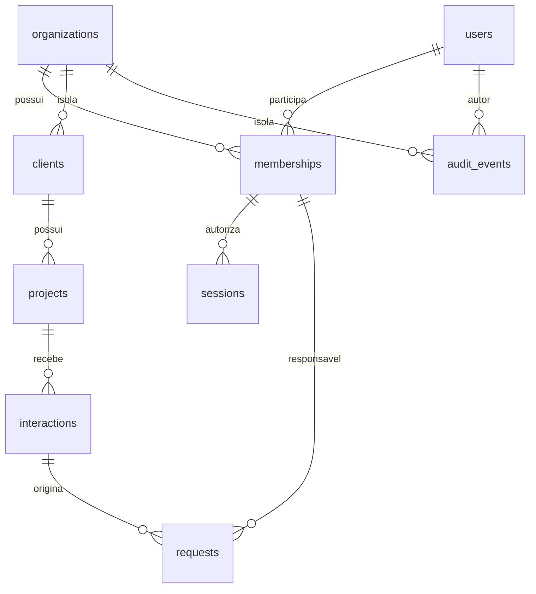

# Arquitetura do Catus OS — M3

## Estrutura e decisões

Monólito modular: Bun.serve + TypeScript strict, Svelte 5 com runes/Vite, PostgreSQL como fonte de verdade. SQL explícito via `pg`, sem ORM, microserviços, Kubernetes ou fila externa. `embedded-postgres` é somente tooling local, com dados em disco e banco PostgreSQL real. A stack e o fluxo funcional M0 foram mantidos; seu token compartilhado foi removido da autenticação.

`openid-client` 6.8.8 é a dependência adicionada ao servidor para protocolo e validação OIDC. Implementar JWT/OAuth manualmente aumentaria risco. A configuração usa discovery HTTPS, Authorization Code com PKCE S256, state, nonce e verificação explícita de assinatura (`enableNonRepudiationChecks`). Claims de issuer/audience/exp/nonce são verificados pela biblioteca; email verificado e domínio Workspace são exigidos pela política local. Não há fallback quando configuração está ausente/parcial; não há bypass de login em desenvolvimento.

## Módulos e fronteiras

| Área                           | Responsabilidade                                                       | Código                                     |
| ------------------------------ | ---------------------------------------------------------------------- | ------------------------------------------ |
| Configuração                   | Origem exata, HTTPS, conjunto OIDC completo                            | `src/server/config.ts`                     |
| OIDC                           | Discovery, desafio, callback, claims, vinculação de identidade         | `src/server/auth/oidc.ts`                  |
| Sessões/cookies                | Digests, expiração, CSRF, revogação e organização                      | `src/server/auth/session.ts`, `cookies.ts` |
| Políticas/auditoria            | Permissões com negação padrão e autor verificado                       | `src/server/auth/policy.ts`                |
| Membros                        | Provisionar, alterar papel e revogar no escopo atual                   | `src/server/modules/memberships.ts`        |
| Clientes/projetos/atendimentos | Contexto manual no escopo da organização                               | `src/server/modules/`                      |
| Solicitações                   | Workflow, responsável real, versão e regras do desenvolvedor           | `src/server/modules/requests.ts`           |
| Mission Control                | Snapshot consistente, membros e auditoria da organização               | `src/server/modules/mission-control.ts`    |
| Transporte                     | Rotas, sessão, CSRF, payload, transação e erros                        | `src/server/app.ts`                        |
| Frontend                       | Login, sessão/organização, formulários, cartões e administração mínima | `src/web/`                                 |
| Extração                       | Adaptador LLM HTTPS, fila persistente e revisão humana                 | `src/server/extraction.ts`                 |

O transporte constrói `Context` somente após consultar sessão e vínculo no banco. Esse contexto contém conexão transacional, usuário, organização e papel atual; módulos não recebem identidade do payload nem usam pool global. Cada função pública de módulo verifica sua permissão. Toda escrita de negócio e seu evento de auditoria pertencem à mesma transação. O `Context` é fronteira interna confiável, não uma estrutura deserializável do cliente.

## Identidade e autorização

```mermaid
sequenceDiagram
 participant U as Funcionário
 participant A as Catus/Bun
 participant P as Provedor OIDC
 participant D as PostgreSQL
 U->>A: GET auth/login
 A->>D: state hash + nonce + PKCE verifier (10min)
 A-->>U: Cookie de state HttpOnly e redirect
 U->>P: Authorization Code + PKCE S256
 P-->>U: Redirect com code/state
 U->>A: callback + cookie state
 A->>D: Consome transação de login
 A->>P: Troca code usando verifier e autenticação do cliente
 P-->>A: ID token
 A->>A: Verifica assinatura, issuer, audience, nonce, exp, email e hd
 A->>D: Localiza usuário provisionado e vínculo ativo
 A->>D: Vincula sub se pendente; cria digest de sessão e auditoria
 A-->>U: Cookie de sessão opaco; redirect para origem fixa
 U->>A: API com cookie; CSRF nas escritas
 A->>D: Sessão válida + membro/usuário ativos + papel atual
 A->>D: Operação filtrada por organização e evento atômico
```

Não há signup público ou concessão automática por domínio. O primeiro administrador é provisionado por CLI offline com acesso administrativo ao banco; esse caminho é bloqueado quando já existe administrador ativo. Ações do CLI ficam explicitamente como `offline-bootstrap`, sem inventar um autor autenticado.

Provisionamento cria usuário com issuer/email e `subject` nulo. Primeiro login exige email verificado do issuer configurado e vincula `sub`. Logins seguintes priorizam issuer/sub; email não religa conta já vinculada a outro subject. Administradores autorizam membros somente na organização atual. Não podem alterar o próprio papel ou revogar a si mesmos; demais papéis não gerenciam acesso. Não há endpoints para o usuário definir papel, ator ou organização arbitrária. Alterações de papel passam a valer na próxima requisição porque não são guardadas como autoridade em JWT/cookie.

| Operação                                      | administrator        | manager              | po                   | developer                                                                                      |
| --------------------------------------------- | -------------------- | -------------------- | -------------------- | ---------------------------------------------------------------------------------------------- |
| Ler operação e membros                        | Sim                  | Sim                  | Sim                  | Sim                                                                                            |
| Criar cliente/projeto/atendimento/solicitação | Sim                  | Sim                  | Sim                  | Não                                                                                            |
| Triar/atribuir/reabrir solicitações           | Sim                  | Sim                  | Sim                  | Não                                                                                            |
| Atualizar solicitação                         | Todas da organização | Todas da organização | Todas da organização | Só atribuída a si, sem reatribuição; execução/bloqueio/conclusão ou manutenção do estado atual |
| Ler auditoria                                 | Sim                  | Sim                  | Não                  | Não                                                                                            |
| Gerenciar membros                             | Sim, exceto si mesmo | Não                  | Não                  | Não                                                                                            |

Os estados M0 e suas transições permanecem: `new→triage`, `triage→ready/blocked`, `ready→in_progress/triage/blocked`, `in_progress→done/blocked`, `blocked→triage/ready/in_progress`, `done→triage`. Manter estado permite atualizar próxima ação/responsável conforme o papel. Desenvolvedor não assume a atribuição a si por payload, não cria demanda nem reabre para triagem.

## Sessões e proteção HTTP

Token opaco aleatório de 256 bits; somente SHA-256 no banco. Cookie HttpOnly, Path=/, SameSite=Lax; Secure e prefixo `__Host-` quando origem HTTPS. HTTP permitido somente em loopback fora de produção. Origem e redirect são valores fixos de ambiente, sem confiar no Host/Forwarded do cliente. Os tokens OIDC não são armazenados.

Sessão expira em 8h ou após 30min de inatividade; `last_seen_at` é atualizado no máximo uma vez por minuto. Logout/revogação escrevem no banco, não apenas apagam cookie. Desativação de usuário/vínculo bloqueia sessões existentes. Troca autorizada de organização revoga a sessão antiga e emite novo cookie/CSRF; remover ou trocar issuer OIDC bloqueia uso das sessões incompatíveis. Sem auto-refresh ou sessão persistente em localStorage.

Escritas exigem origem exata e token CSRF ligado à sessão via header; GET de login/callback usa state de uso único e cookie de binding. Cookies duplicados são rejeitados. API limita JSON a 32KiB, valida UUID, enum, texto e datas, usa queries parametrizadas e não expõe SQL/claims/segredos em erros. Respostas são `no-store` e não enviam CORS aberto. Conexões ao banco têm pool 10 e timeouts de conexão/statement de 5s. Sessões são travadas para atualização e vínculos para leitura durante a operação; revogação não retorna antes de escritas concorrentes previamente autorizadas terminarem.

## Dados e isolamento



Migration `001_initial.sql` permanece intacta. `002_identity.sql` adiciona:

- `organizations`, `users` (únicos issuer/sub e issuer/email), `memberships` (papel e ativo), `sessions` e `oidc_transactions`.
- `organization_id NOT NULL` em todas as entidades M0/auditoria; os registros anteriores recebem a organização Catus, sem exclusão/reescrita de conteúdo.
- Uniques e FKs compostas `(id, organization_id)` entre clientes/projetos/atendimentos/solicitações. Um vínculo entre organizações é inválido mesmo com IDs reais.
- `owner_user_id` opcional para registros legados, com FK composta para membro da mesma organização. Novas solicitações pela API exigem membro ativo; não aceitam só nome.
- `actor_user_id`, tipo e ID da entidade na auditoria. Eventos históricos preservam `local-developer` e autor nulo; não são atribuídos retroativamente a uma pessoa.

O antigo `requests.owner` fica como snapshot textual preservado, inclusive após vinculação explícita. A leitura usa nome atual do usuário quando vinculado; a coluna operacional é `owner_user_id`. Não há correspondência automática por nome. Auditoria cobre criação de todas as entidades, atualização de solicitações, membros, login, logout, revogação e troca de organização. Os eventos registram ator, entidade, ação e horário; não são um histórico completo de diffs de cada campo.

Todas as leituras/escritas de negócio usam organização obtida da sessão. IDs externos de outras organizações retornam inexistência; responsáveis externos são recusados sem expor dados do usuário. Membros e auditoria também são filtrados. O Mission Control usa uma única instrução SQL para todas as coleções, mantendo snapshot MVCC consistente sem perder o controle concorrente otimista do M0. Atualização de solicitação usa lock de linha + versão, com 409 em versão desatualizada. Migrations continuam com transação e advisory lock.

Isolamento é aplicado no serviço e por constraints relacionais; **RLS não foi implementado**. Operadores com credencial direta do banco têm acesso privilegiado e estão fora da fronteira de usuários da aplicação. A separação runtime/migrations/manutenção foi implementada no M1.1: dono do banco/schema é migrator, runtime tem grants mínimos e auditoria append-only, manutenção lê/remove só tabelas transitórias. O entrypoint verifica privilégios; launcher remove URLs elevadas e desliga carregamento automático de .env no processo web. Isolamento de SO/arquivos entre operadores e runtime ainda exige configuração do proprietário em host compartilhado. RLS continua como defesa adicional futura.

## Testes e limites da entrega

Banco de teste loopback separado terminado em `_test`, com guardas contra uso do banco do aplicativo. Testes de API usam PostgreSQL real; teste de migration cria schema isolado com registros M0 e confirma preservação. Provedor OIDC simulado fica exclusivamente em `tests/support`, assina tokens RS256 e atravessa a mesma biblioteca de validação. Harness de browser exige `NODE_ENV=test`; o servidor normal não importa testes nem tem modo de impersonação. O browser cobre dois papéis e uma organização externa, sessão após reload e logout.

A integração Google real requer configuração/credenciais de desenvolvimento e rede; não foi validada sem esses pré-requisitos. CI M1 passou no GitHub Actions, observado pela página pública do run 41220332080; a API de logs/status permanece bloqueada pelo proxy (detalhes em `docs/GIT_REVIEW.md`). Nenhuma main/default, produção, merge ou deploy foi alterado.

## Hardening M1.1

Migration incremental `003_hardening.sql` adiciona `rate_limits` e `idempotency_keys`, com índices de retenção. Incrementos de rate limit são autocommit independentes da operação: 20/min auth e 300/min API por peer TCP fornecido pelo Bun, nunca por headers de encaminhamento. Rejeição 429 inclui Retry-After; falha do limitador fecha acesso com 503. Cotas persistem entre processos/restarts.

Criações exigem UUID Idempotency-Key. Chave composta por organização/usuário/rota/chave, JSON canônico e resposta persistidos na mesma transação que negócio/auditoria. Unique constraint serializa retries concorrentes; payload divergente retorna 409, rollback não deixa sucesso registrado. Autorização/CSRF atuais são verificados antes do replay. Retenção de 24h é limite da garantia, não deduplicação permanente.

Worker externo `npm run cleanup` usa conta maintenance, advisory lock, lotes de 500 e timeout de 5s a cada 60s. Limpa sessões expiradas/inativas/revogadas, states, rate buckets antigos e idempotência vencida; preserva sessões ativas, negócio e auditoria. Agendamento/supervisão do processo cabe ao operador.

Bun entrega build `dist` em HTTPS loopback com certificado/CA local explícitos, CSP self-only e sem proxy trust implícito. Credenciais Google reais não são usadas em testes. Perfil offline Google valida origem HTTPS, issuer, client ID e hd; protocolo, claims, cookies Secure e CSRF são exercitados em TLS real com IdP simulado apenas em testes. Teste rejeita CA não confiável.

Backup usa pg_dump custom oficial 18.3 por imagem Docker fixada por digest; streaming AES-256-GCM com chave privada separada, fsync e rename. Restore valida autenticação antes de executar SQL, só em banco local vazio \*\_restore_test, transação única e ACLs reatribuídas; invalida sessões/states/cache/limites. Tests comparam conteúdo de negócio e auditoria, recusam adulteração e alvo preenchido. Não há restauração automática sobre banco existente nem recuperação de produção.

Procedimento completo e tarefas do proprietário em `docs/HOMOLOGATION.md`. Permanecem pendentes: Google real, trust dos perfis de navegador, isolamento de SO/segredos, supervisão do worker, políticas de retenção de auditoria/backups, métricas e logs correlacionados. Não confundir preparação validada com autorização de exposição/produção.

## M2 — Atendimento inteligente

Migrations 004/005 preservam o M0/M1 e acrescentam políticas, orçamento de IA, jobs, propostas/revisões e rastreabilidade das demandas; tipos de contexto passam a incluir conversa e observação, além dos antigos meeting/service.

`src/server/ai/provider.ts` implementa OpenAI-compatible Chat Completions por fetch HTTPS nativo, sem SDK/dependências extras. Schema estrito versionado, ausência de ferramentas, separação de mensagem de sistema/dados, citações literais com offsets calculados e limites de bytes/tokens/tempo. Modelo, preços e política são configurados no ambiente; sem chave legítima/configuração, inferência fica indisponível. Nenhum mock é importado pelo aplicativo/worker normal. Schema e quote não provam implicação semântica: PO confere e corrige antes de criar trabalho.

`extraction_jobs` captura fonte/hash, ator solicitante, policy/model/prompt/limites/preços, estado, tentativas, lease e uso/custo estimado. API reserva orçamento por organização/dia UTC e retorna 202. Worker faz claim SKIP LOCKED e commit antes do HTTP; chamada externa não ocupa transação HTTP. Uma tentativa/job, lease 90s, deadline até 60s, sem retry automático de cobrança ambígua. Jobs interrompidos, dias expirados, mudança de configuração/política/identidade não são reenviados. Redução de orçamento é verificada antes do envio. Sem usage válido, consumo conservador da reserva não é apresentado como fatura real.

A conta AI worker tem URL isolada e não pode INSERT requests, UPDATE propostas ou gerir acesso; só preenche campos não decisórios de propostas e atualiza execução/orçamento. Web não recebe a credencial desse worker. O processo web usa sessão/CSRF e papel PO/gestor/admin para revisar. Edições/rejeições gravam snapshots imutáveis com autor; aprovação em lote usa versões/locks/idempotência, cria somente as selecionadas com responsável e ação, liga proposta↔request e audita tudo na mesma transação. A geração termina em propostas não aprovadas; nem IA nem worker aprovam escopo/contrato.

Duplicidades são heurísticas locais e limitadas a 500 candidatos do projeto/organização, recalculadas antes de aprovar. Nunca enviadas ao modelo nem usadas para fusão automática. Aprovar candidato exige confirmação adicional. Mission Control mostra a origem da proposta e critérios revisados.

Restore invalida material de sessão e impede reexecução dos jobs queued/running restaurados, marcando falha com revisão necessária e orçamento conservador. Não há limpeza automática do histórico de IA; retenção/redação é tarefa operacional posterior.

Fluxo, campos, limites, critérios de política e execução em `docs/AI_INTAKE.md`. A autorização de desenvolvimento M2 usa dados sintéticos; não conclui homologação Google/LLM real nem autoriza enviar dados reais. Contratos, horas, economia e execução agêntica continuam fora deste marco.

## M3 — Contratos e escopos versionados

Issue #1, baseline M2 `cf34cbc`, branch própria `feat/m3-scope-contracts`. Migrations incrementais 006/007: contracts, commercial_policies, scope_versions/items/contributors/decisions, change_requests, commercial_events e vínculo opcional requests.scope_item_id. FKs compostas asseguram organização/projeto/cliente; triggers congelam conteúdo submetido/itens e termos contratuais ativados, validam origens/cobertura por projeto. Migrations 001–005 permanecem intactas e demandas antigas continuam sem cobertura inferida.

`src/server/modules/commercial.ts` concentra regras sob Context M1 e transação HTTP; `src/shared/commercial.ts` define contratos e referências para M4; `src/web/CommercialControl.svelte` fornece cadastro, política, revisão/decisão, change requests e cobertura. Não há dependência nova, worker comercial, chamada externa ou cálculo financeiro. Contratos têm tipo explícito, moeda, vigência UTC e referência textual; ativação/encerramento são registros humanos por gestor/admin, sem assinatura/valores inferidos. Termos ativados não são editados; substituição documental exige novo contrato.

Escopo por projeto tem numeração monotônica e contador separado de concorrência. Uma versão pendente e uma aprovada por projeto (uniques parciais). Advisory lock por organização/projeto serializa criação/transições; decisão única, locks de linha/política/contrato e versões impedem duas aprovações. Conteúdo submetido é imutável. Nova versão de escopo aprovado exige change request com motivo/impacto, cópia de itens/contribuidores e decisão humana independente. Aprovação substitui a versão anterior atomicamente; rejeição conserva a base. Revisões de rejeição inicial também criam versão nova, sem sobrescrever conteúdo/decisão anterior.

Default deny comercial: sem política explícita ninguém decide. Só admin configura alçada limitada aos papéis gestor/admin. Autor, editores e submissor são contribuidores; cópias herdam participação e todos são impedidos de decidir o próprio trabalho. Decisão registra ator, papel, hora, revisão e snapshot de política. PO prepara e submete; desenvolvedor só lê. Tenant/ator/papel nunca são aceitos do frontend. Eventos comerciais before/after e auditoria M1 pertencem à mesma transação. Criações/submissões/decisões/cobertura usam idempotência M1.1; PATCH usa revisão otimista/409. AI worker não recebe grants M3 nem UPDATE(scope_item_id) em requests; maintenance continua sem dados comerciais.

Cobertura exige vínculo humano a item da versão atualmente aprovada, contrato ativo/vigente e mesmo projeto/organização. Mission Control calcula cobertura independente de status M0: ready/M2 accepted não são aprovação comercial. Substituição de versão ou encerramento/expiração de contrato preserva vínculos/histórico, porém os sinaliza pendentes para nova análise; nenhum vínculo migra automaticamente para V2. M0 não sofre bloqueio operacional retroativo. `CommercialBasis` fornece IDs/tipo/moeda/vigência/versionamento para M4, sem valores, estimativas ou margens fictícios.

Guia completo e checklist em `docs/SCOPE_CONTRACTS.md`. Testes usam PostgreSQL real, contas SQL restritas e fixtures sintéticos; validam concorrência, tenant, preparadores, contratos expirados, falha tardia de auditoria/rollback, upgrade M2 e backup/restore. Playwright cobre PO/gestor/admin e organização externa, mantendo regressões M0–M2. Google/LLM reais e piloto corporativo permanecem sujeitos à homologação do proprietário.
