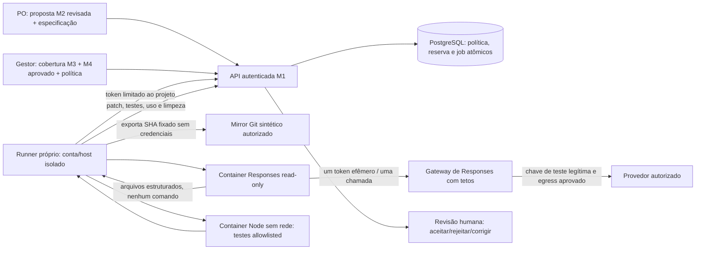
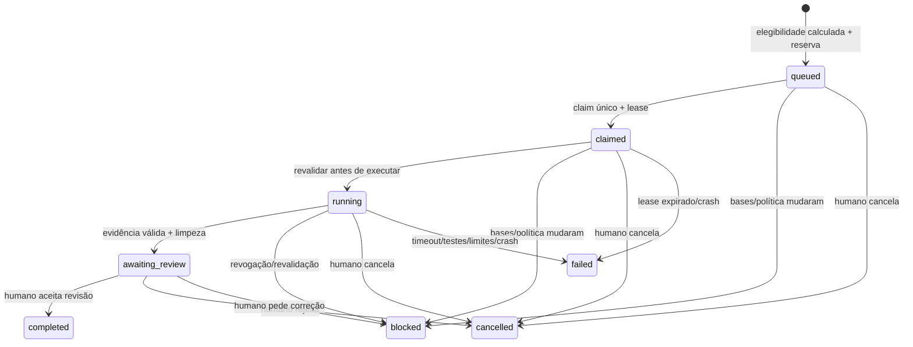

# M5 — Entrega agêntica controlada · Nuvemshop primeiro

## Atualização M5.1 — contrato vigente

O SDK/CLI 0.166.0 foi reproduzido contra recusa loopback sem chave real: anuncia ferramentas e usa streaming. Está **desativado**. O adaptador separado `ResponsesAgent` usa Responses HTTP/JSON direto, `text.format: json_schema` estrito, tools vazio e uma chamada, sem retry. Não é execução do Codex SDK/Cloud. `harness: responses-api` é explícito na política/resultado/UI; políticas antigas SDK falham fechadas e precisam de nova autorização humana. Migrations 001–009 preservadas.

O gateway reconstrói o payload a partir de campos permitidos, fixa modelo/schema/teto, nega streaming, estado/storage/URLs/ferramentas e valida conclusão, usage, arquivos/bytes antes de devolver JSON. A resposta é validada novamente no container e executor. Recusa/truncamento/tool call/usage ausente ou inválido não produz patch aceito. Falha ambígua consome a autorização, sem retry. Tokens e preços continuam separados da margem M4.

llm_verified=true identifica somente um resultado Responses recebido pelo runner confiável, não certificação global do SDK, conta ou modelo. Fixtures continuam false. Nenhuma inferência real foi realizada nesta preparação. Aceite externo **NOT_VERIFIED**, PR **NOT_CREATED**. Leia [REAL_AGENT_ACCEPTANCE.md](REAL_AGENT_ACCEPTANCE.md) para diagnóstico, comandos e checklist do proprietário. Os registros de instalação do SDK abaixo são históricos; não habilitam o SDK.

[Issue #3](https://github.com/marcelotaparelli/catus-os/issues/3), baseline M4 `613d0cc46bd199be344beb661824bcdc44ccdcbc`, branch `feat/m5-agentic-delivery`. Migrations 001–008 e histórico preservados; migration 009 aditiva. Não houve merge, deploy, produção, criação de main/default, uso de clientes reais ou inferência comercial por IA.

## O que foi efetivamente validado

| Fronteira                              | Evidência / situação                                                                                                                                             |
| -------------------------------------- | ---------------------------------------------------------------------------------------------------------------------------------------------------------------- |
| Regras, autorizações e fila PostgreSQL | Funcionando: M2 humano → cobertura M3 → bases M4 completas/aprovadas → política → um job automático, sem duplicação                                              |
| Runner isolado sobre repo fixture      | **Execução real validada**: exportação de Git, alteração de template, testes Node reais em Docker, diff, SHA, limites e limpeza                                  |
| Desenvolvimento por LLM/Codex real     | **NOT_VERIFIED**: sem credencial legítima de provedor/gateway. Fixture determinístico existe somente em testes; não é inferência                                 |
| SDK legado (desativado)                | `@openai/codex-sdk` e CLI **0.166.0** instalados somente para prova loopback de incompatibilidade; não invocados no runtime M5.1                                 |
| PR remoto do agente                    | **NOT_CREATED**: nenhum repo remoto fixture foi criado, nenhuma credencial GitHub de escopo mínimo foi disponibilizada/validada para ele. Patch fica no Catus OS |

O SDK legado envolve a CLI local e foi desativado; o cliente ativo fala Responses diretamente. Não há API de criação de tarefas do Codex Cloud aqui. Uma execução própria do runner, mesmo em uma VM remota, não é Codex Cloud. Credencial herdada do ambiente de desenvolvimento para Git não é licença para entregar uma credencial pessoal ampla ao agente; o launcher a remove.

**Não declarar aceite end-to-end de Codex real nesta entrega.** O fluxo completo foi exercitado com CodeAgent claramente test-only, filesystem/processos/testes reais. Aceite externo legítimo permanece procedimento do proprietário abaixo.

## Arquitetura mínima



O broker fica na API existente; não há Redis, Kubernetes, novo serviço de domínio, worker com banco financeiro ou orquestrador genérico. O runner/gateway são processos de infraestrutura externos sob administração do operador. Não recebem credenciais financeiras/contratuais. `CodeAgent` desacopla geração de arquivos da fila e dos testes. O primeiro adaptador é patch-first: **um turno limitado gera conteúdos de arquivos permitidos**, o executor aplica por código e executa comandos fixos de teste. Não há shell do agente no host, publicação ou ferramentas comerciais.

Módulos:

- `src/server/delivery/config.ts`: default OFF, allowlist pública operacional, autorização de disponibilidade; não contém caminhos de mirror ou chaves.
- `service.ts`: elegibilidade, reservas, fila, claim/start/heartbeat/finish, revisão, auditoria e revalidação.
- `runner/src/core.ts`: Git/export restrito, mudanças validadas, Docker, limites, watchdog, patch e limpeza.
- `responses-agent.ts`/`responses-entry.ts`/`responses.ts`: cliente Responses isolado e validação de contrato; `codex-agent.ts`/`sdk-entry.ts` negam execução do SDK.
- `gateway.ts`: uma chamada Responses autorizada/job, tetos antes do envio, sem tools/storage/retries e resposta limitada; servidor Bun separado em `gateway-server.ts`.
- `src/web/DeliveryControl.svelte`: política, observação, especificação, motivos de bloqueio, fila/diff/testes e revisão humana.

## Política e elegibilidade

Default OFF / deny. Gestor/admin registra autorização auditada para um projeto da organização, escolhendo repo/ref/SHA de allowlist operacional, caminhos exatos, harness Responses API, tarefa `nuvemshop-theme`, limites e justificativa. Uma tentativa por versão de especificação; concorrência 1–2; até 20 jobs/dia; tempo total 5–120s; entrada 1000–32000 tokens, saída 128–4096; patch até 8192 bytes. Preços/tetos monetários são entradas explícitas do gestor, sem cotação inventada.

Elegibilidade é calculada a partir do banco atual, não flag fornecida pelo browser:

1. Demanda `ready`, atribuída a membro ativo. Preparador e autorizador ainda têm papéis/participações ativos.
2. Especificação humana suficientemente preenchida (mínimos 30/15 caracteres, não validação semântica), tipo Nuvemshop e declaração `synthetic`. Revisão humana deve conferir sentido, origem M2 e critérios; tamanho de texto não prova qualidade.
3. Item de escopo **atualmente** aprovado, contrato ativo/vigente em UTC e mesmo projeto/organização. Snapshot da origem contém atendimento/proposta M2 quando existentes.
4. Última observação M4 do projeto é de competência/corte atuais, fresca conforme política, sem incompletudes de projeção/realizado; cobertura coincide com M3 e há estimativa do responsável/demanda. Restante positivo não excede capacidade declarada; margem projetada ≥ limiar explícito.
5. Gestor/admin diferente do autor aprovou explicitamente essa observação para uso em execução. Isso não reescreve M4 nem inventa novo valor financeiro.
6. Nenhuma decisão econômica relevante ou apontamento/decisão de horas mudou depois da observação. Mudanças de repo/ref/política, escopo, atribuição ou versão da demanda invalidam o hash de base.
7. Saldo diário/total e número de jobs permitem reserva. Configuração de runner autorizada e repo/ref/caminhos continuam na allowlist.

`ready`, margem positiva, aceite M2 ou cobertura M3 isolados não autorizam nada. Dados financeiros insuficientes não são convertidos em zero. O runner recebe somente especificação/aceite e limites operacionais; não recebe salários, valores de contrato, fontes financeiras completas, sessões, usuários ou ferramentas da API Catus.

O enfileiramento acontece **na mesma transação** das escritas de negócio que tornam o caso elegível, inclusive especificação, política e aprovação da observação: job/reserva/eventos juntos equivalem a outbox durável sem mensagem externa. GET não cria trabalho. O serviço considera até 100 candidatos por organização por ciclo de reconciliação; não é scheduler genérico. Claim reavalia, start reavalia imediatamente antes do trabalho e heartbeat/finish reavaliam durante/depois. Atualizar allowlist operacional exige reiniciar API/runner com os manifests novos; branch do mirror é conferida novamente no executor.

## Estados, idempotência, crash e decisões



“Eligible” é resultado calculado, não estado persistido que poderia envelhecer. Status do job é separado da demanda; aceitar revisão **não** muda demanda para done, não integra código nem aprova contrato.

Unique por `spec_id`, unique parcial para job ativo por demanda, lock por organização e transações serializam tentativas/claims/reservas. Criações/ativações/decisões humanas exigem UUID Idempotency-Key e conferem papel/CSRF. Mesma chave/conteúdo retorna a resposta existente; conflitos/versões/estados retornam 409. TTL 24h segue M1.1, mas unicidade/estado final impedem novo job da mesma especificação fora do cache. Correção exige decisão/cancelamento do ativo e uma nova versão humana explícita; não é retry autônomo.

Lease = tempo máximo + 120s; tentativa é no máximo 1. Claim sem resposta, falha externa ambígua e crash não autorizam reenvio do job. Recuperação torna failed e exige revisão. Broker não mantém transação durante geração/testes; runner consulta heartbeat a cada 500ms. Revogação/bases alteradas bloqueiam jobs; runner aborta ao receber cancel/erro de autorização e mata seus containers. Watchdog Node dentro de cada container encerra o grupo de processos no teto mesmo se o cliente Docker desaparecer. Isso limita execução residual, mas não recolhe dados já enviados ao provedor antes de revogação.

Eventos/specs/reviews/aprovações de observação são append-only. Autoria humana vem da sessão; eventos do runner/broker têm ator de serviço e autor humano null, sem fingir que agente é pessoa. Recusas autenticadas M5 ficam auditadas após rollback somente com rota/código/identidade verificada, sem corpo/segredo. Sem identidade/tenant legítimos, aplicar negação/rate limit sem inventar organização. Falha de auditoria de recusa gera log seguro de indisponibilidade, não sucesso de negócio.

## Custos e limites independentes do modelo

Unidade operacional: **microUSD inteiros**, preços por milhão de tokens e valores decimais canônicos. Reserva/job, teto diário e teto total persistidos e verificados sob lock. Máximo estimado de tokens/preços não pode exceder a reserva:

```text
max_estimado_microUSD = ceil((input_max × preço_input_microUSD_por_milhão
                            + output_max × preço_output_microUSD_por_milhão) / 1.000.000)
```

Gateway consome autorização de uma chamada **antes** de enviar HTTP, recusa segunda chamada/retry, input excessivo, tools e armazenamento. Encaminha modelo fixado pelo operador e `max_output_tokens` limitado, independentemente do pedido do cliente/modelo. Não permite redirects ou destinos vindos do atendimento. Resposta limitada a 64 KiB, timeout finito e nunca encaminha erro/chave/header do provedor. Não aceita streaming/SSE; Responses retorna JSON completo validado. Campos fora do contrato, estado anterior e tools são recusados antes do upstream. Logs do gateway não contêm prompt, corpo do provedor ou tokens de acesso.

Sem usage confiável/custo conhecido, `consumed_micro_usd` debita conservadoramente a **reserva**; não é mostrado como fatura/custo real. Com usage válido e preços explícitos, registrar estimativa. Falha/crash após claim consome reserva, sem reexecutar chamada ambígua; bloqueio antes de claim libera a reserva, preservando contagem de tentativas/dia. Reservas de dia UTC anterior não iniciam chamada nova. Mudanças de preço fora do sistema não são observáveis: configurar também limite/conta de teste no provedor; não alegar garantia sobre fatura externa ou tarifa desconhecida.

Uso do agente é categoria própria USD. **Não** somar USD a BRL, converter câmbio ou alterar snapshots M4 automaticamente. Limiar M4 e limite USD são duas autorizações independentes, não uma margem “pós-agente” artificial. Uma política de câmbio/custo total pós-agente exigirá trabalho aprovado separado.

## Threat model e enforcement

| Ameaça                                           | Fronteira aplicada                                                                                                                                                                                                                                                                     |
| ------------------------------------------------ | -------------------------------------------------------------------------------------------------------------------------------------------------------------------------------------------------------------------------------------------------------------------------------------- |
| Prompt injection em conversa/especificação/repo  | Origem é JSON de dados; geração sem autoridade comercial, ferramentas negadas pelo gateway; validação de paths/bytes/saída fora do modelo                                                                                                                                              |
| Escrever fora do repo/escopo ou ler segredos     | Exportar só blobs 100644 allowlisted; sem symlinks/submodules/.env/chaves; writes por código só em paths exatos de template/static; container não monta host/backend ou socket Docker                                                                                                  |
| Alterar testes/build/CI ou instalar dependências | Escrita somente templates/snipplets `.tpl`, static CSS/JS permitidos; package/lock/arquivos privados fora do escopo. Comandos são arrays `node --test <paths>` no manifest confiável, nunca texto do atendimento/modelo                                                                |
| Repo/base substituídos                           | URL lógica, branch e SHA iguais à allowlist da API e do runner; `refs/heads/...` do mirror deve corresponder ao SHA antes de exportar                                                                                                                                                  |
| Execução destrutiva, rede, fork/CPU/memória      | Testes com `--network none`, root/worktree readonly, cap-drop ALL, no-new-privileges, UID/GID não root do supervisor (mesmo proprietário dos bind mounts privados), pids 32, memória/swap 128 MiB, CPU 0,5, nofile 128, limite de arquivo e tmpfs 16 MiB; watchdog e remoção observada |
| Credenciais roubadas por código/modelo           | Runner não aceita URLs PostgreSQL/chaves upstream/GitHub; launcher allowlist de env. Container teste sem credenciais; cliente Responses recebe só token efêmero de gateway, não chave upstream/broker/GitHub                                                                           |
| Explorar cliente para tools/deploy/merge         | Container read-only e sem executor de tools; gateway recusa qualquer tools e chamadas extras; resposta só arquivos validáveis; nenhum remoto no Git de trabalho, push/merge/deploy/tag/release não existem no executor                                                                 |
| Forjar caminhos/saídas/consumo                   | Runner e API conferem arquivos, headers do diff, SHA, tamanho, comandos/exit 0 e tokens dentro do teto; fixture não é aceito pela configuração normal                                                                                                                                  |
| Cross-tenant/forjar papel/custo                  | Tenant/papel humanos da sessão, token de runner limitado a org/projeto, grants mínimos, runner sem banco e sem rotas financeiras/contratuais/membros                                                                                                                                   |
| Restore/crash reativar trabalho pago             | Marcar interrompidos failed/review, liquidar reserva conservadora, limpar leases, revogar tokens e desativar políticas após restore; nenhuma nova tentativa implícita                                                                                                                  |

Containers compartilham kernel do host: não alegamos isolamento de VM contra vulnerabilidade de kernel/Docker. Docker socket é poder elevado e fica **apenas no supervisor confiável**, em host/conta dedicados sem banco/segredos de clientes. Nunca montar esse socket no agente ou testes. Declaração `synthetic` e detecção de padrões de segredo não são detector universal de PII; operador/humano deve autorizar o conteúdo e revisar repo/diff. Apenas fixtures neste marco.

## Preparação reproduzível

### Aplicação e testes locais

```sh
npm ci
npm --prefix runner ci --ignore-scripts
# PostgreSQL loopback já ativo conforme README/HOMOLOGATION
npm run db:roles
npm run migrate
npm run test:db
npm run check
npm run build
npm run tls:local
# Docker local: clientes PostgreSQL M1.1 e imagem Node fixada
npm test
npm run format:check
npm run test:e2e
```

Neste ambiente, Chromium usa `CHROMIUM_PATH=/tmp/chromium npm run test:e2e`. APIs e Playwright sequenciais, pois regressão/harness compartilham `_test`. Testes M5 usam repo Git temporário sintético, fixture CodeAgent e containers Docker **reais**; pacote de testes do tema é dado `.fixture`, copiado para `tests/theme.test.mjs` somente no repo temporário e executado somente no container. O teste pré-correção deve falhar; pós-correção passa, com provas de RO/root/rede/cgroup/ausência de segredos.

SDK versionado isoladamente em `runner/package.json`/lock, Node >=22.12 para strip-types; Bun/TypeScript strict continuam na API. SDK oficial 0.166.0 fica somente para reprodução de incompatibilidade, desativado no runner. A imagem ativa não instala SDK/CLI. CLI instalada e imagem são suporte de execução, não evidência de credencial válida.

### Allowlist e mirror do runner remoto próprio

1. Proprietário prepara host/conta dedicada, Docker saudável e repo **sintético autorizado**, sem serviços/credenciais de produção. Não usar repo cliente. Preparar mirror Git local sem hooks/credenciais persistidas no repo. Não criar/alterar main ou branch padrão.
2. Fixar branch explícita e SHA de commit já revisado. Templates do primeiro caso precisam existir no baseline; novos arquivos não são suportados nesta fatia sem provisionar nova base. O executor não instala dependências nem escolhe comandos livremente.
3. Copiar/editar `runner/examples/api-repositories.json` para arquivo privado de configuração da API (sem mirror path) e `runner/examples/runner-repositories.json` para conta do runner. Substituir org/repo/branch e SHA zero por valores reais de **teste autorizado**; os exemplos não apontam a entrega remota existente. Nos testes, a URL `catus-synthetic/nuvemshop-theme` é somente identificador lógico; nenhum repo GitHub com esse nome é criado ou clonado.
4. Configuração normal da API inicia com `DELIVERY_ENABLED=false`. `DELIVERY_REPOSITORIES_FILE` aponta à allowlist pública; ativação de capacidade exige `DELIVERY_ENABLED=true` e `DELIVERY_RUNNER_ATTESTATION=isolated-responses-capped-gateway-v1`. A attestation é decisão operacional explícita, **não prova automática** de suporte/credenciais. Só definir após validar sandbox/gateway/conta de teste real. Sem isso, mostrar unavailable e não invocar agente.

### Imagens, proxy e rede privada

`runner/Dockerfile` e `runner/Gateway.Dockerfile` não publicam serviço. Base Node fixada por digest. Cliente Responses não instala dependências nem precisa de segredo de build; gateway usa o binário Bun já instalado pelo npm no Linux x64. `.dockerignore` exclui .env/.local/.git e permite somente o binário Bun necessário dos node_modules de tooling, não segredos.

```sh
# Exemplos de build local, não implantação; seguir runtime skill para proxy/CA.
docker --host=unix:///var/run/docker.sock build \
  -f runner/Dockerfile -t catus-codex-reviewed .
docker --host=unix:///var/run/docker.sock build \
  -f runner/Gateway.Dockerfile -t catus-codex-gateway-reviewed .
# Registrar o image ID sha256:... revisado em DELIVERY_CODEX_IMAGE.
```

Não desativar TLS, não usar danger/full-access, host networking ou rota alternativa para contornar egress. `CODEX_PROXY_CERT` é o caminho da CA pública do ambiente; não é chave. Fora do ambiente gerenciado, fornecer a CA aprovada equivalente. Responses container só pode entrar em rede Docker **internal**, nome `catus-codex-...`, conferida via inspect pelo executor. Gateway deve ter alias `delivery-gateway` nessa rede e egress separado/limitado ao provedor autorizado via proxy/CA. **Não publicar portas Docker**. API acessível ao supervisor só por HTTPS privado/túnel autorizado; não acessível ao container Responses/teste. Testes sempre `--network none`.

O gateway pode rodar com Bun na conta privada (`127.0.0.1` por padrão) ou na imagem revisada. Bind `0.0.0.0` só é aceito com `CODEX_GATEWAY_CONTAINER_ONLY=true` para container privado sem publish, nunca como serviço público. Credenciais próprias em env-file 0600, nunca argumentos com valores/tokens, repo ou chat. Configurar proxy/CA no gateway conforme ambiente; builds foram testados, rede upstream/conta real não foram. Operador deve conferir isolamento de rede/alias/egress antes da attestation.

### Credenciais separadas e inicialização

| Serviço             | Variáveis privadas/operacionais                                                                                                                                                                        |
| ------------------- | ------------------------------------------------------------------------------------------------------------------------------------------------------------------------------------------------------ |
| API                 | Só allowlist/attestation M5; nenhuma credencial Codex/GitHub/gateway/runner                                                                                                                            |
| Supervisor runner   | `DELIVERY_API_URL`, `DELIVERY_RUNNER_TOKEN`, `DELIVERY_RUNNER_REPOS_FILE`, `DELIVERY_CODEX_NETWORK`, `DELIVERY_CODEX_IMAGE`, `CODEX_GATEWAY_CONTROL_URL`, `CODEX_GATEWAY_CONTROL_TOKEN`, `CODEX_MODEL` |
| Gateway             | `CODEX_GATEWAY_CONTROL_TOKEN`, `CODEX_UPSTREAM_KEY` legítima de teste, `CODEX_UPSTREAM_RESPONSES_URL` HTTPS explícita, `CODEX_MODEL`; proxy/CA e bind privado                                          |
| Responses container | Somente token efêmero, URL interna do gateway e modelo; não chave upstream, token Catus ou GitHub                                                                                                      |

O operador local provisiona uma credencial de runner com escopo org/projeto e TTL 8h usando o migrator, em operação offline auditada, não pela conta do agente:

```sh
npm run delivery:token -- ORG_UUID PROJECT_UUID .local/runner-token.env
# Transferir o arquivo 0600 somente à conta dedicada, por canal seguro autorizado.
# Para revogar (ID registrado no evento offline, sem imprimir token):
npm run delivery:token -- --revoke ORG_UUID PROJECT_UUID RUNNER_UUID
```

CLI só aceita banco loopback `catus`/`*_test`, não sobrescreve arquivo e guarda no banco apenas SHA-256. Runner token permite somente claim/start/heartbeat/finish do projeto; não autentica nas demais APIs. Não transportar arquivo `.local/database.env` ao runner. Revogar política para cessar imediatamente novas execuções; credencial revogada interrompe in-flight no heartbeat, lease terminal sem retry quando recuperado.

Com env-file privado apropriado na conta dedicada:

```sh
node --env-file=/caminho/privado/runner.env scripts/delivery-runner.mjs --once
# Remover --once para polling; supervisão/stop ficam com o operador.
node --env-file=/caminho/privado/gateway.env scripts/delivery-runner.mjs --gateway
```

O launcher usa allowlist de env e remove DB/finance/GitHub/provider keys do runner; main também recusa credenciais indevidas. Não lê o auth/cache da sessão Codex pessoal, não reaproveita `GH_TOKEN` herdado para o agente e não faz login interativo. Sem configuração, `npm run delivery:runner -- --once` termina código **2** unavailable / Codex real NOT_VERIFIED, sem claim/inferência. A chave upstream só existe no gateway; cada job recebe autorização de uma chamada. Serviço gateway sem suas credenciais falha fechado.

### Aceite externo Responses legítimo — pendente; SDK desativado

1. Disponibilizar conta/chave de teste e orçamento/tarifas legítimos, egress específico e repo sintético permitido. Não extrair chave de outro produto/sessão. Confirmar gateway com Responses compatível, TLS e tetos reais da conta.
2. Buildar/revisar imagens e rede internal; confirmar cliente Responses/modelo com no-tools e container read-only. O gateway **recusa tools**, estado retomado, storage e chamadas extras. Se modelo exigir tools obrigatórias ou depender de várias chamadas, esse modo falha fechado; não remover limites para declarar sucesso. Compatibilidade de inferência/schema/modelo permanece NOT_VERIFIED até esse teste legítimo.
3. Autorizar política/revisar observação M4 na UI e repetir a tarefa sintética. Registrar base SHA/job/versão, testes/códigos, patch, usage quando recebido, limite/estimativa USD e limpeza. Conferir ausência de credenciais e de alterações fora da allowlist.
4. Somente resultado vindo do `ResponsesAgent` real pode apresentar `llm_verified=true`. Fixture nunca serve como aceite de IA. No sucesso, ainda aguardar revisão humana; aceite não integra código.
5. PR remoto exige repositório/base autorizados existentes e credencial separada de escopo mínimo. Publicação automática/PR não foi habilitada nesta fatia: patch é a entrega revisável suportada. Não reutilizar credencial Git ampla; implementar/publicar um adapter de PR separado somente com essa configuração/autorização. Nenhum merge/deploy/tag/release.

## API, restore e observabilidade

| Método | Rota                                      | Autorização/função                                                                                                       |
| ------ | ----------------------------------------- | ------------------------------------------------------------------------------------------------------------------------ |
| GET    | `/api/delivery`                           | Sessão/tenant; motivos, políticas, specs, últimos 100 jobs e 200 eventos. Custos operacionais detalhados só gestor/admin |
| POST   | `/api/delivery/policies`                  | Gestor/admin: projeto, versão atual (0 inicial), enabled explícito, settings allowlisted, razão                          |
| POST   | `/api/delivery/specs`                     | PO/gestor/admin: request_id, revision atual (0 inicial), task_type, specification, acceptance, data_scope synthetic      |
| POST   | `/api/delivery/reports/:id/approve`       | Gestor/admin independente do criador M4; razão                                                                           |
| POST   | `/api/delivery/jobs/:id/review`           | Gestor/admin: accepted/rejected/correction_requested + razão; aceite reavalia bases                                      |
| POST   | `/api/delivery/jobs/:id/cancel`           | Gestor/admin: razão                                                                                                      |
| POST   | `/api/delivery-runner/claim`              | Bearer de runner/projeto, corpo vazio; tarefa/lease ou null                                                              |
| POST   | `/api/delivery-runner/jobs/:id/start`     | Bearer + lease; revalidar antes de executar                                                                              |
| POST   | `/api/delivery-runner/jobs/:id/heartbeat` | Bearer + lease; cancel flag ou erro encerra execução                                                                     |
| POST   | `/api/delivery-runner/jobs/:id/finish`    | Bearer + lease; result validado ou failure_code seguro                                                                   |

Rotas humanas mantêm sessão/CSRF/origem/tenant; runner não é um usuário privilegiado simulado, usa rota autenticada própria e não acessa Context financeiro. Alterações de spec/política exigem revisão atual/409. Fila é a outbox PostgreSQL, nenhuma chamada externa dentro da transação humana. Revalidação e limites usam dados reais do banco; status/log de job não implica conclusão operacional da demanda.

Backup M1.1 inclui novas entidades. Restore marca queued/claimed/running como failed/restored_requires_review, liquida reservas conservadoramente, limpa leases, revoga todos os runners e desativa/incrementa políticas com evento `backup-restore`. Resultado/patch/reviews concluídos permanecem. Reaplicar grants e exigir nova autorização/token; não reativar jobs pagos/restaurados. Teste usa pg_dump/pg_restore reais e confirma evidência preservada e nenhuma credencial/política ativa.

## Limites e pendências honestas

Somente Nuvemshop sintético, arquivos existentes e testes Node sem dependências nesta fatia. Não foi validado renderer/loja/API Nuvemshop real. Até 100 candidatos/jobs e 200 eventos na UI; manifests carregados no startup. Containers dependem de Linux/Docker/cgroup v2; sandbox diferente deve falhar fechado e ser homologado. Rede privada, confiança de CA, retenção de artefatos, supervisão e credenciais de operador são tarefas da instalação; o código não prova essa infraestrutura só por env flag. Compatibilidade/no-tools do modelo real e PR remoto pendentes, sem fingir Codex Cloud. Fórmulas M4 e snapshots não foram alterados; nenhuma execução real de LLM ocorreu.
