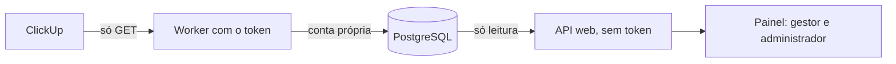

# Integração ClickUp, somente leitura (M6.1)

Leva tarefas do ClickUp ao painel dos sócios, sem escrever nada no ClickUp e sem criar demandas no Catus OS. Fica desligada por padrão: sem configuração, nenhuma tela, rota ou chamada externa existe.

**Estado:** implementada e testada com um ClickUp simulado, baseado na documentação pública. **Nunca foi executada contra um workspace real.** A forma real das respostas, em especial de `assignees` e `dependencies`, ainda precisa ser conferida.

## Como funciona



| Peça                                         | Responsabilidade                                                       |
| -------------------------------------------- | ---------------------------------------------------------------------- |
| `src/server/clickup/client.ts`               | Única saída de rede, só GET; ritmo, limite de corpo e erros por código |
| `src/server/clickup/parse.ts`                | Valida a resposta e guarda só os campos necessários                    |
| `src/server/clickup/sync.ts`                 | Reserva, leitura completa, gravação em transação e reconciliação       |
| `src/server/clickup/summary.ts`              | Regras puras do painel                                                 |
| `src/server/clickup/service.ts`              | Rotas web e dados de execução no `/api/overview`                       |
| `scripts/clickup-worker.ts`                  | Processo que detém o token                                             |
| `db/migrations/012_clickup_readonly.sql`     | Tabelas novas, somente aditivas                                        |
| `db/migrations/013_clickup_status_scope.sql` | Lista principal da tarefa e mapeamento por lista, somente aditivos     |
| `db/migrations/014_clickup_task_links.sql`   | Vínculo por tarefa principal, somente aditivo                          |

### Decisões

- **Tarefas ficam à parte.** Vivem em `clickup_tasks` e nunca viram `requests`. Uma tarefa em várias listas é uma linha só, ligada às listas por `clickup_list_tasks`.
- **Vínculo por tarefa principal ou por lista.** Na Catus, a lista `Projetos` é compartilhada: cada tarefa principal é um projeto de cliente, e as subtarefas são as atividades. O vínculo por tarefa lê só essa tarefa e as descendentes, com `GET /task/{id}?include_subtasks=true` por tarefa, e nunca a lista. Os outros clientes não são pedidos nem guardados. O vínculo por lista continua para listas de um projeto só. Ver "Vínculo por tarefa principal".
- **Lê tudo, depois grava.** A lista inteira, ou a árvore inteira da tarefa, é lida sem transação aberta e gravada de uma vez. Falha ou HTTP 429 em qualquer chamada não altera nada.
- **Ausência só por leitura completa.** Tarefa que sumiu recebe `missing_since` e não é apagada; se voltar, a marca sai.
- **Token só no worker.** O lançador da web o remove do ambiente. A conta de banco do worker não lê economia, contratos, demandas nem usuários; a conta da web não grava as tabelas que o worker preenche.
- **Uma organização e um workspace por token.** O worker só atende `CLICKUP_ORGANIZATION_ID` e recusa a leitura inteira se uma tarefa vier de outro workspace. A API web esconde as rotas das demais organizações.
- **Dados mínimos.** Não guarda descrição, comentários, campos personalizados, e-mail nem a resposta bruta. Erros registram só um código e o status HTTP.
- **Status explícitos, por lista.** O status original é preservado. Bloqueio e espera do cliente só contam por mapeamento feito por um sócio; nada é deduzido do nome. Ver "Escopo do mapeamento de status".
- **Sem invenção.** Não há percentual de conclusão nem previsão de entrega. Contagem que não se pode saber sai como "Não disponível".

### Regras do painel

| Situação                                | O que aparece                                         |
| --------------------------------------- | ----------------------------------------------------- |
| Alguma lista do projeto nunca foi lida  | Nenhuma contagem, com "Não disponível" e o motivo     |
| Última leitura falhou                   | Últimos números reais, com aviso e data deles         |
| Última leitura com mais de 60 minutos   | Últimos números reais, com aviso e data deles         |
| Status sem mapeamento e nenhum bloqueio | Bloqueadas e Aguardando cliente como "Não disponível" |
| Campo opcional inválido                 | Campo vazio e aviso de dados incompletos              |
| Prazo sem horário                       | Só conta como atraso depois de passado o dia inteiro  |
| Papéis PO e desenvolvedor               | Nada: nem no `/api/overview`, nem nas rotas (403)     |

O painel lê `status.type` para separar abertas de concluídas: `closed` e `done` são concluídas, e qualquer outro tipo conta como aberta.

### Escopo do mapeamento de status

No ClickUp, os status são definidos por espaço, pasta ou lista. O mesmo nome, como "em espera", pode significar "bloqueada" numa lista e "aguardando cliente" em outra. Um mapeamento só por organização aplicaria o sentido de uma lista às outras sem aviso.

| Regra                        | Como funciona                                                                                                                                           |
| ---------------------------- | ------------------------------------------------------------------------------------------------------------------------------------------------------- |
| Lista que define o status    | A lista principal da tarefa (`list.id` da resposta, em `clickup_tasks.home_list_id`). Sem ela, as listas vinculadas do projeto em que a tarefa foi lida |
| Precedência                  | Mapeamento da lista (`clickup_list_status_mappings`) e, na falta dele, o da organização (`clickup_status_mappings`)                                     |
| Listas candidatas discordam  | Sem lista principal conhecida e com sentidos diferentes: o status fica sem mapeamento e a contagem sai como "Não disponível"                            |
| Mapeamento salvo pelo painel | Vale só para a lista indicada ao lado do status. Só sai como "todas as listas" (organização) quando a lista é ambígua                                   |
| Dados do M6.1                | Mapeamentos por organização continuam valendo como padrão. Tarefas sem lista principal recebem o campo na próxima leitura                               |

A API aceita `list_id` opcional em `POST /api/clickup/status-mappings`. A lista precisa estar vinculada na organização ou ser a lista principal de uma tarefa guardada. A alteração é auditada como `clickup_list_status_mapping`.

### Vínculo por tarefa principal

| Regra                          | Como funciona                                                                                                                                                                                                                                        |
| ------------------------------ | ---------------------------------------------------------------------------------------------------------------------------------------------------------------------------------------------------------------------------------------------------- |
| Entrada                        | Task ID ou endereço `https://app.clickup.com/t/<id>`, em Vínculos > "Tarefa principal". IDs personalizados não são aceitos                                                                                                                           |
| Hierarquia                     | Cada subtarefa é lida por conta própria e precisa ter como `parent` quem a listou; `top_level_parent`, quando vem, precisa ser o projeto; toda subtarefa citada precisa ser alcançada pelo próprio pai. Senão, `hierarchy_mismatch` e nada é gravado |
| Tarefa que não é principal     | `not_top_level`, nada é gravado                                                                                                                                                                                                                      |
| Tamanho                        | Até 500 tarefas e 10 níveis; acima disso, `too_many_tasks`, nada é gravado                                                                                                                                                                           |
| Ausente desde a última leitura | Lida de novo: fechada mas ainda no projeto, volta; apagada ou em outro projeto, sai dos números                                                                                                                                                      |
| Painel                         | A tarefa principal aparece à parte, com o próprio status e o significado mapeado, prazo e responsáveis. Ela não entra em nenhuma contagem. As atividades (filhas diretas) e as subtarefas delas são contadas por status                              |
| Mapeamento                     | O mesmo da lista principal (`Projetos`), para a tarefa principal e para as atividades. O status da tarefa principal sem mapeamento não torna desconhecidos os bloqueios das atividades                                                               |

A documentação do ClickUp não diz se `subtasks` traz um nível ou todos, nem se inclui fechadas. O código não depende disso, e os testes cobrem os dois comportamentos. Se `include_subtasks` não trouxer as fechadas, as que já estavam fechadas antes da primeira leitura ficam de fora. A homologação confere isso (`CLICKUP_HOMOLOGACAO.md`, seção 6).

## O que falta para conectar um projeto real

O proprietário precisa decidir ou fornecer:

1. Autorização para a primeira leitura e o local dela. A recomendação é um banco novo e separado, para não tocar no banco local do Arch.
2. Conta de serviço no ClickUp, com token próprio e acesso só ao projeto do piloto (de preferência a tarefa principal compartilhada com ela, senão a lista). Ver o plano do workspace, que define o limite de chamadas.
3. O ID do workspace, o ID da organização no Catus OS e o Task ID da tarefa principal do projeto (ou o ID de uma lista dedicada).

Num clone novo, só para isso, o fluxo assistido prepara e confere tudo e para antes da primeira chamada ao ClickUp:

```sh
bun run clickup:homolog init   # marca o clone; recusa diretório com .local ou .env
bun run dev:local              # noutro terminal
bun run clickup:homolog        # banco, migrations, conta e privilégios do worker, OIDC, token e vínculo
bun run clickup:token          # o proprietário digita o token, sem eco; arquivo 0600 fora do repositório
```

O worker lê o token de `CLICKUP_API_TOKEN_FILE` como dado, nunca com `source`. `CLICKUP_API_TOKEN` no ambiente continua aceito, mas não os dois juntos.

Procedimento completo, com ambiente descartável, token fora do repositório, comparação de dados, critérios de aceite e rollback: [`CLICKUP_HOMOLOGACAO.md`](CLICKUP_HOMOLOGACAO.md).

`clickup:role` segue a mesma guarda de `db:roles` e só aceita banco em loopback. A VPS precisará de um caminho próprio, ainda não escrito, assim como um serviço supervisionado para o worker.

**Aceite do piloto, a conferir pelo proprietário:**

- Os totais de um projeto batem com o ClickUp.
- Status personalizados, responsáveis e dependências aparecem como no ClickUp.
- Um token inválido mostra o erro e mantém os números antigos.
- `clickup_sync_runs` registra cada leitura, e o token não aparece em logs.

## Limites conhecidos

- A leitura completa consome uma chamada por página a cada 15 minutos por lista, ou uma chamada por tarefa do projeto num vínculo por tarefa.
- Limite de 200 páginas (20.000 tarefas) por lista; acima disso a leitura falha, visivelmente, sem gravar.
- Prazo sem horário usa a tolerância de um dia porque o fuso do workspace não é lido.
- `clickup_people.user_id` existe, mas ainda não há tela para ligar uma pessoa do ClickUp a um usuário do Catus OS.
- `clickup_sync_runs` cresce sem limpeza automática: cerca de 35 mil linhas por ano e por lista.
- Tarefas arquivadas saem da leitura e aparecem como removidas da lista.
