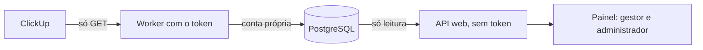

# Integração ClickUp, somente leitura (M6.1)

Leva tarefas do ClickUp ao painel dos sócios, sem escrever nada no ClickUp e sem criar demandas no Catus OS. Fica desligada por padrão: sem configuração, nenhuma tela, rota ou chamada externa existe.

**Estado:** implementada e testada com um ClickUp simulado, baseado na documentação pública. **Nunca foi executada contra um workspace real.** A forma real das respostas, em especial de `assignees` e `dependencies`, ainda precisa ser conferida.

## Como funciona



| Peça                                     | Responsabilidade                                                       |
| ---------------------------------------- | ---------------------------------------------------------------------- |
| `src/server/clickup/client.ts`           | Única saída de rede, só GET; ritmo, limite de corpo e erros por código |
| `src/server/clickup/parse.ts`            | Valida a resposta e guarda só os campos necessários                    |
| `src/server/clickup/sync.ts`             | Reserva, leitura completa, gravação em transação e reconciliação       |
| `src/server/clickup/summary.ts`          | Regras puras do painel                                                 |
| `src/server/clickup/service.ts`          | Rotas web e dados de execução no `/api/overview`                       |
| `scripts/clickup-worker.ts`              | Processo que detém o token                                             |
| `db/migrations/012_clickup_readonly.sql` | Tabelas novas, somente aditivas                                        |

### Decisões

- **Tarefas ficam à parte.** Vivem em `clickup_tasks` e nunca viram `requests`. Uma tarefa em várias listas é uma linha só, ligada às listas por `clickup_list_tasks`.
- **Lê tudo, depois grava.** A lista inteira é lida sem transação aberta e gravada de uma vez. Falha ou HTTP 429 em qualquer página não altera nada.
- **Ausência só por leitura completa.** Tarefa que sumiu recebe `missing_since` e não é apagada; se voltar, a marca sai.
- **Token só no worker.** O lançador da web o remove do ambiente. A conta de banco do worker não lê economia, contratos, demandas nem usuários; a conta da web não grava as tabelas que o worker preenche.
- **Uma organização e um workspace por token.** O worker só atende `CLICKUP_ORGANIZATION_ID` e recusa a leitura inteira se uma tarefa vier de outro workspace. A API web esconde as rotas das demais organizações.
- **Dados mínimos.** Não guarda descrição, comentários, campos personalizados, e-mail nem a resposta bruta. Erros registram só um código e o status HTTP.
- **Status explícitos.** O status original é preservado. Bloqueio e espera do cliente só contam por mapeamento feito por um sócio, por organização; nada é deduzido do nome.
- **Sem invenção.** Não há percentual de conclusão nem previsão de entrega. Contagem que não se pode saber sai como "Não disponível".

### Regras do painel

| Situação                                | O que aparece                                         |
| --------------------------------------- | ----------------------------------------------------- |
| Alguma lista do projeto nunca foi lida  | Nenhuma contagem, com "Não disponível" e o motivo     |
| Última leitura falhou                   | Últimos números reais, com aviso e data deles         |
| Última leitura com mais de 60 minutos   | Últimos números reais, com aviso e data deles         |
| Status sem mapeamento e nenhum bloqueio | Bloqueadas e Aguardando cliente como "Não disponível" |
| Campo opcional inválido                 | Campo vazio e aviso de dados incompletos              |
| Prazo sem horário                       | Só conta como atraso depois de passado o dia inteiro  |
| Papéis PO e desenvolvedor               | Nada: nem no `/api/overview`, nem nas rotas (403)     |

O painel lê `status.type` para separar abertas de concluídas: `closed` e `done` são concluídas, e qualquer outro tipo conta como aberta.

## O que falta para conectar um projeto real

O proprietário precisa decidir ou fornecer:

1. Autorização para a primeira leitura e o local dela. A recomendação é um banco novo e separado, para não tocar no banco local do Arch.
2. Conta de serviço no ClickUp, com token próprio e acesso só às listas do piloto. Ver o plano do workspace, que define o limite de chamadas.
3. O ID do workspace, o ID da organização no Catus OS e o ID de uma lista de um projeto.

Depois, no ambiente escolhido e fora deste repositório:

```sh
bun run clickup:role     # cria a conta de banco do worker
bun run migrate          # aplica a 012
# no ambiente privado: CLICKUP_ENABLED=true, CLICKUP_API_TOKEN, CLICKUP_ORGANIZATION_ID, CLICKUP_WORKSPACE_ID
# reiniciar a API para ela enxergar CLICKUP_ENABLED e CLICKUP_ORGANIZATION_ID
# vincular a lista no painel: projeto > Execução no ClickUp > Listas vinculadas
bun run clickup:worker -- --once   # uma leitura, para conferir
```

`clickup:role` segue a mesma guarda de `db:roles` e só aceita banco em loopback. A VPS precisará de um caminho próprio, ainda não escrito, assim como um serviço supervisionado para o worker.

**Aceite do piloto, a conferir pelo proprietário:**

- Os totais de um projeto batem com o ClickUp.
- Status personalizados, responsáveis e dependências aparecem como no ClickUp.
- Um token inválido mostra o erro e mantém os números antigos.
- `clickup_sync_runs` registra cada leitura, e o token não aparece em logs.

## Limites conhecidos

- A leitura completa consome uma chamada por página a cada 15 minutos por lista.
- Limite de 200 páginas (20.000 tarefas) por lista; acima disso a leitura falha, visivelmente, sem gravar.
- Prazo sem horário usa a tolerância de um dia porque o fuso do workspace não é lido.
- O mapeamento de status vale para a organização inteira, embora o ClickUp permita o mesmo nome com sentidos diferentes por lista.
- `clickup_people.user_id` existe, mas ainda não há tela para ligar uma pessoa do ClickUp a um usuário do Catus OS.
- `clickup_sync_runs` cresce sem limpeza automática: cerca de 35 mil linhas por ano e por lista.
- Tarefas arquivadas saem da leitura e aparecem como removidas da lista.
